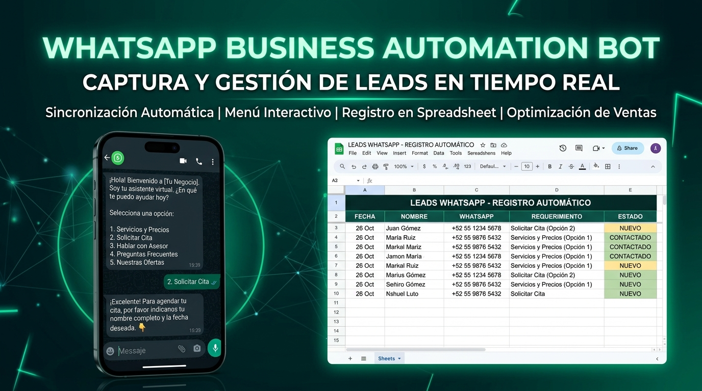
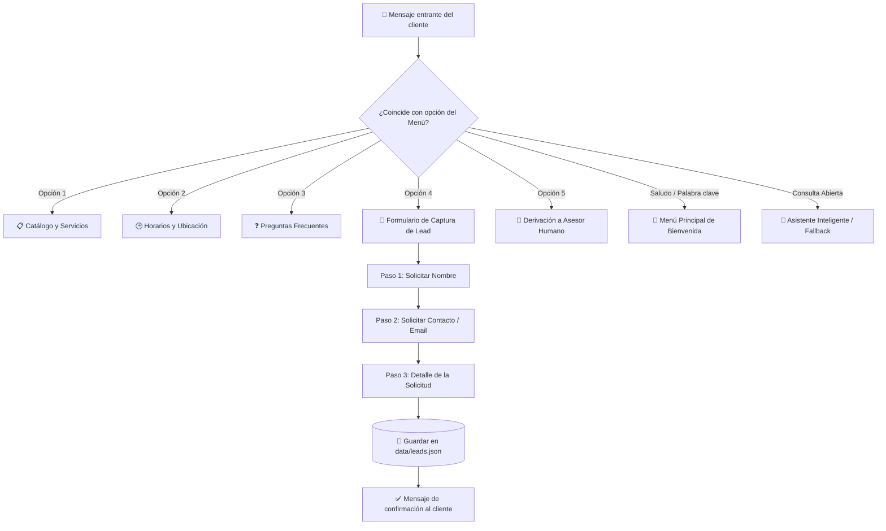

# 🤖 WhatsApp Business Bot — Automatización de Respuestas sin Inversión Inicial ($0 Cost)

[](https://nodejs.org/)
[](https://builderbot.app)
[-blueviolet)](https://github.com/WhiskeySockets/Baileys)
[](#)
[](LICENSE)



Solución integral y de código abierto para la **automatización de respuestas en WhatsApp** diseñada para emprendimientos y PyMEs. Permite gestionar consultas frecuentes, exhibir servicios, capturar clientes potenciales (*leads*) y canalizar soporte humano sin incurrir en costos de suscripción mensual ni APIs de pago.

---

## 🎯 Problema de Negocio y Solución

| Desafío Habitual | Solución de este Proyecto |
| :--- | :--- |
| **Pérdida de clientes fuera de horario:** Consultas desatendidas por las noches y fines de semana. | **Atención 24/7:** Respuestas inmediatas automatizadas ante cualquier mensaje entrante. |
| **Altos costos en plataformas SaaS:** Herramientas como ManyChat o Landbot cobran tarifas recurrentes elevadas. | **Cero Inversión Inicial ($0):** Utiliza tecnologías Open Source (Node.js + Baileys) sin cuotas mensuales. |
| **Riesgo de bloqueo o baneo de número:** Bots agresivos son detectados como spam por WhatsApp. | **Diseño Anti-Ban:** Respuestas únicamente entrantes (*Inbound*), tiempos de espera simulados (*delays* humanos de 1.2s) y navegación conversacional no invasiva. |
| **Pérdida de datos de prospectos:** Consultas dispersas en chats individuales sin seguimiento. | **Captura estructurada en Excel y JSON:** Registro automatizado de datos de contacto y requerimientos en `data/leads.xlsx` y `data/leads.json`. |

---

## ⚡ Características Principales

1. **📋 Menú Interactivo Dinámico:** Opciones rápidas para consultar catálogo de servicios, horarios de atención y preguntas frecuentes (FAQ).
2. **📊 Captura de Leads a Excel (.xlsx) y Google Sheets en la nube:** Formulario conversacional interactivo que solicita nombre, medio de contacto y requerimiento, guardándolo tanto en una hoja de cálculo local como sincronizándolo en tiempo real con **Google Sheets** (ver [Guía de Google Sheets](docs/GOOGLE_SHEETS_SETUP.md)).
3. **👤 Derivación a Asesor Humano:** Canalización formal cuando el cliente requiere atención personalizada o soporte especializado.
4. **🧠 Módulo de Respuestas Inteligentes:**
   - Modo Base ($0): Detección por palabras clave de intención (precios, horarios, ubicación).
   - Modo IA Opcional: Integración directa con **Google Gemini (Capa Gratuita)** para resolver preguntas abiertas en lenguaje natural.
5. **🛡️ Mecanismos de Seguridad Anti-Ban:**
   - Retardo de tipeo configurable (`RESPONSE_DELAY_MS`).
   - Arquitectura orientada a eventos *Inbound* (solo responde cuando el usuario inicia el diálogo).

---

## 🔄 Diagrama de Flujo Conversacional



---

## 📂 Estructura del Proyecto

```text
├── src/
│   ├── app.js                 # Inicialización del bot y servidor HTTP
│   ├── config.js              # Configuración centralizada y parámetros anti-ban
│   ├── flows/
│   │   ├── welcomeFlow.js     # Menú de bienvenida y fallback inteligente
│   │   ├── catalogFlow.js     # Catálogo de servicios y soluciones
│   │   ├── scheduleFlow.js    # Horarios, ubicación y canales de contacto
│   │   ├── faqFlow.js         # Respuestas a preguntas frecuentes
│   │   ├── leadFlow.js        # Captura y validación de prospectos (leads)
│   │   └── advisorFlow.js     # Transferencia a asesor humano
│   └── services/
│       ├── leadStorage.js     # Persistencia local de datos (JSON estructurado)
│       └── aiService.js       # Asistente con IA (Gemini Free Tier / Reglas)
├── data/
│   └── leads.json             # Registro generado de clientes capturados
├── .env.example               # Plantilla de variables de entorno
├── .gitignore                 # Exclusión de credenciales y sesiones
└── package.json               # Dependencias y scripts de ejecución
```

---

## 🚀 Puesta en Marcha (Instalación Rápida)

### Requisitos Previos
- [Node.js](https://nodejs.org/) v20 o superior instalado en el equipo.
- Una cuenta de WhatsApp activa en un teléfono móvil (se sugiere un número secundario o chip prepago para pruebas de desarrollo).

### 1. Clonar el repositorio e instalar dependencias
```bash
git clone https://github.com/tu-usuario/whatsapp-bot-cero-costo.git
cd whatsapp-bot-cero-costo
npm install
```

### 2. Configurar variables de entorno
Copia el archivo `.env.example` a `.env`:
```bash
cp .env.example .env
```

*(Opcional)* Si deseas activar respuestas con IA generativa, puedes colocar tu clave gratuita de [Google AI Studio](https://aistudio.google.com/) en la variable `GEMINI_API_KEY`. Si no colocas ninguna, el bot funcionará automáticamente con el motor de reglas $0.

### 3. Iniciar el bot
```bash
npm start
```
*(Para modo desarrollo con recarga automática: `npm run dev`)*

### 4. Escanear el Código QR
1. Abre WhatsApp en tu teléfono.
2. Ve a **Dispositivos vinculados > Vincular un dispositivo**.
3. Escanea el código QR que se imprime directamente en tu terminal (o visualízalo abriendo `http://localhost:3008` en tu navegador).
4. ¡Listo! Tu bot ya está respondiendo interacciones en tiempo real.

---

## 💼 Cómo presentar este proyecto a un cliente o propuesta freelance

Si estás aplicando a ofertas de trabajo como:
> *"Automatización de Respuestas en Whatsapp sin Inversión Inicial"*

Puedes destacar en tu propuesta:
1. **Compromiso $0:** La solución corre en Node.js sobre Baileys y almacena datos localmente, evitando costos fijos de servidores de bases de datos o plataformas de terceros.
2. **Cuidado del número:** Explicas proactivamente que el sistema incorpora *delays* humanos de 1200ms y opera bajo modelo *Inbound* para proteger la reputación del número de WhatsApp.
3. **Escalabilidad:** Si el negocio escala en el futuro a miles de mensajes diarios, la arquitectura modular permite migrar fácilmente hacia la API Oficial de Meta (WhatsApp Cloud API) sin rehacer la lógica de flujos.
4. **Entrega de valor inmediata:** Registro estructurado de cada lead capturado para que el equipo comercial pueda hacer seguimiento de ventas.

---

## 📄 Licencia

Este proyecto está bajo la Licencia [MIT](LICENSE). Puedes utilizarlo, modificarlo y adaptarlo libremente para proyectos comerciales y personales.
